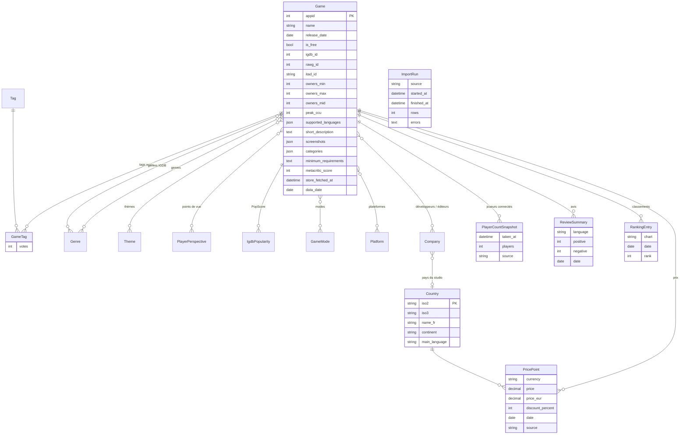

# Modèle de données

L'**appid Steam** relie toutes les sources : chaque import retrouve son jeu par l'appid (IGDB,
RAWG et IsThereAnyDeal ont leur propre identifiant, rangé dans `Game`). Aucune donnée
personnelle : seulement des comptes par jeu, pays, langue ou date.

| App | Modèles |
|---|---|
| `catalog` | `PlayerPerspective`, `IgdbPopularity` (PopScore IGDB), `ReviewExcerpt` (extraits d'avis anonymes, pour T-40), `Game`, `Genre`, `Tag`, `GameTag`, `Theme`, `GameMode`, `Platform`, `Company`, `ReviewSummary` |
| `geography` | `Country` (rempli par `geography.country_table.ensure_countries`), `RegionalSales` |
| `pricing` | `PricePoint` |
| `players` | `PlayerCountSnapshot`, `TwitchStreamSnapshot`, `RankingEntry` (top 100 SteamSpy) |
| `ingestion` | `ImportRun` (une ligne par import lancé : début, fin, lignes, erreurs) |

Les contraintes d'unicité (`GameTag` jeu + tag, `PricePoint` jeu + pays + date + source…)
rendent les imports idempotents : relancer un import met à jour au lieu de dupliquer.

## Écrire un import

Chaque source traduit ses réponses en `GameRecord` et les confie à
`ingestion.writing.GameWriter(data_date)` : paquets de 500, aucun doublon, liens (genres, tags,
studios, plateformes) ajoutés, votes de tags, temps de jeu et avis mis à jour. `data_date` est la
date des données : un jeu déjà rempli par une source plus récente ne voit que ses champs vides
comblés (« la donnée la plus récente gagne »). L'import s'enveloppe dans
`ingestion.import_tracking.tracked_import(source)`, qui remplit `ImportRun`.
