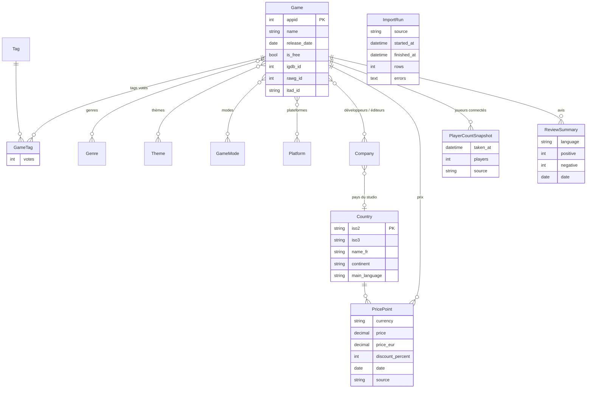

# Modèle de données

L'**appid Steam** relie toutes les sources : chaque import retrouve son jeu par l'appid (IGDB,
RAWG et IsThereAnyDeal ont leur propre identifiant, rangé dans `Game`). Aucune donnée
personnelle : seulement des comptes par jeu, pays, langue ou date.

| App | Modèles |
|---|---|
| `catalog` | `Game`, `Genre`, `Tag`, `GameTag`, `Theme`, `GameMode`, `Platform`, `Company`, `ReviewSummary` |
| `geography` | `Country` |
| `pricing` | `PricePoint` |
| `players` | `PlayerCountSnapshot` |
| `ingestion` | `ImportRun` (une ligne par import lancé : début, fin, lignes, erreurs) |

Les contraintes d'unicité (`GameTag` jeu + tag, `PricePoint` jeu + pays + date + source…)
rendent les imports idempotents : relancer un import met à jour au lieu de dupliquer.
